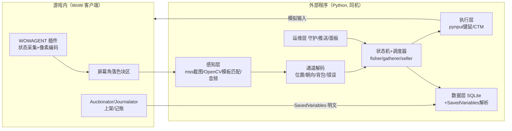

# 魔兽世界正式服自动化系统 · 技术落地计划 v1

> **实现状态（2026-11-06）**：全量代码已落地并测试通过（27 项测试 + 合成环境端到端自测 PASS）——插件、感知/控制/业务模块、CLI 工具链见 [README.md](README.md)；待真机执行 [docs/SETUP.md](docs/SETUP.md) 的校准与 7 项 PoC 后即可逐模块上线。后续调研记录见 [docs/无限服Forever分析-2026-11.md](docs/无限服Forever分析-2026-11.md)。

> 目标：在国服正式服（当前为《午夜》12.x 时代）实现**单账号自动钓鱼、自动采集（草药/矿石）、拍卖行自动售卖**的本地无人值守系统。技术路线延续前期调研结论：**不读内存、不注入**，采用「游戏内插件状态通道 + 外部程序截图识别 + 键鼠模拟」的成熟架构。
>
> 风险声明（不展开，详见前期对话）：本方案属于暴雪用户协议禁止的自动化操作，封号风险无法消除。**全程使用月卡小号开发、测试、运行，主号零参与。**

---

## 0. 一页速览

| 项 | 结论 |
|---|---|
| 运行平台 | **macOS 为主**（国服正式服有原生 Mac 客户端，支持 Apple 芯片；本机即开发机），Windows 为备选（后端抽象，一天可切换） |
| 核心架构 | 游戏内 Lua 插件把状态编码成屏幕色块 → Python 程序截图解码 + OpenCV 识别 → 状态机决策 → 模拟键鼠 → 插件/画面反馈闭环 |
| 关键依据 | 插件定位 API（`C_Map.GetPlayerMapPosition` / `GetPlayerFacing`）在 12.x 正式服仍可用（仅玩家自身、仅室外），采集钓鱼全在野外，条件满足 |
| 售卖方案 | 定价上架交给 **Auctionator 插件**（游戏内 API 操作，100% 可靠，不依赖 OCR 读价格），外部程序只负责走位和点按钮 |
| 记账方案 | 读 **Journalator** 的 SavedVariables 明文文件 + 插件状态通道实时上报，免 OCR |
| 里程碑 | 6 个阶段，合计约 **20–32 个工作日**；MVP（钓鱼+售卖闭环）约 **6–8 天** |
| 第一步 | Phase 0 环境搭建 + 7 项 PoC 逐项验证（本章 §6），先证明地基可行再写业务 |

---

## 1. 目标与范围

**做**：
- 定点自动钓鱼（开放水域 → 鱼群）
- 地面/飞行双采路线（草药+采矿）
- 背包满后自动回城：拍卖行上架 → 邮箱收金 → 返回作业点
- 7×24 无人值守调度、异常停机与手机推送
- 收益记账与报表（每小时净金币、成交/滞销明细）

**不做（v1 明确排除）**：
- 内存读取/DLL 注入、导航网格生成（工程量大、 arms race，收益不成比例）
- 自动战斗、副本、御风飞行（dynamic flying）
- 自动收购/倒卖、跨角色多开
- 自动登录输密码（涉及凭据安全，断线重连只做到「点进游戏界面」，更深的异常一律停机通知）

**终态验收**：连续 3 天 × 24h 运行，每天人工干预 ≤ 1 次，收益报表自动生成。

---

## 2. 前置事实（本轮调研已确认）

1. **国服正式服有原生 Mac 客户端**，2024-08 国服回归时同步推出，原生支持 Apple 芯片（M 系列）。Mac 上需装 Mac 版战网（battlenet.com.cn）。注意：大脚等国内插件整合包多数无 Mac 版，**插件手动安装**（解压到 `Interface/AddOns`），Auctionator/GatherMate2 等 CurseForge 插件本身跨平台。
2. **当前资料片《午夜》(Midnight, 12.0)**，2026-03-02 全球上线，现为 12.x 中后期补丁。本计划设计为版本无关（模板/坐标全部可配置、按版本目录管理）。
3. **定位 API 现状（关键依赖，已验证）**：
   - `C_Map.GetPlayerMapPosition(uiMapID, "player")`：返回玩家地图坐标（0–1），**10.1.7 起仅对玩家自身有效、仅室外有效**（副本内无效）——采集/钓鱼全在野外，满足。
   - `GetPlayerFacing()`：返回朝向弧度（北=0），同样仅室外有效。
   - 两者是导航闭环的定位数据源，是整个架构成立的前提，**每次大版本补丁后要重新验证**（见 §7 风险表）。
4. **售卖不依赖外部价格服务**：Auctionator 自带游戏内扫描和价格数据库，国服可用；TSM 依赖外部价格源，国服不可控，弃用。
5. 参考项目（前期调研结论，架构可借鉴、代码不可直接套用）：
   - [Xian55/WowClassicGrindBot](https://github.com/Xian55/WowClassicGrindBot)：插件色块→外部解码→寻路→键鼠的完整架构（面向怀旧服）
   - [pixel-bot-go](https://github.com/soockee/pixel-bot-go)：纯视觉钓鱼（鱼漂定位+上钩检测）
   - [WoWAutoFish 分支](https://github.com/HTBNighty/WoWAutoFish)：Electron + OCR + 键鼠，含正式服交互键实践
   - WRobot 等内存方案已停止官方服支持，不采用

---

## 3. 总体架构



**核心原则**：
1. **每一步操作后重新感知，确认成功再进行下一步**——禁止开环固定延时点击。
2. **能用插件 API 拿到的数据绝不 OCR**：位置、朝向、背包、金币、战斗状态、错误信息、施法事件走像素通道；拍卖价格走 Auctionator；只有小地图节点图标、鱼漂、界面按钮用图像识别。
3. **干跑模式**：感知+决策全跑、不注入输入（由人执行），是主要开发调试与回归测试手段。

---

## 4. 核心技术设计

### 4.1 状态通道（插件 → 外部程序）★架构核心

**为什么**：外部程序截图像「看」游戏，拿不到可靠的结构化状态（坐标、背包、错误码）。参考 WowClassicGrindBot 的成熟做法：插件把状态渲染成屏幕固定角落的色块阵列，外部截图解码，得到一条**低误码、高频、免 OCR** 的结构化数据链路。

**编码方案**：
- 渲染区：屏幕左下角固定位置，8 个 16×16 px 色块（避开 UI），`OnUpdate` 节流 10 Hz。
- 每帧 8 块 = 32 bit：`[SYNC(4bit 固定图案)][TYPE(4)][D0–D5(24)][SUM(4)]`，有效载荷 30 B/s。
- 每色块 16 级颜色（RGB 各取高位 2bit 拼接），块间留 2px 暗边防串扰；游戏画面无视频压缩，mss 取原始像素，稳定。
- 解码侧校验：SYNC 匹配 + SUM 校验 + **连续 3 帧一致才采信**，误码率目标 < 1e-3（PoC 实测）。

**数据字典（v1）**：

| TYPE | 内容 | 说明 |
|---|---|---|
| POS | x:12bit, y:12bit | 地图坐标 0–1 量化，精度约 2–5 码，够航向闭环用 |
| HDG | 朝向 12bit | 弧度 0–2π 量化（30bit 精度足够转向控制） |
| STATUS | 位标志 16bit：战斗/死亡/飞行/游泳/施法中/拾取窗开/掉线(UI屏蔽)/坐骑上 | + HP%、背包空闲格数 8bit |
| BAG | 白名单物品 ID→数量摘要 | 分片多帧传输；用于「背包满」与采集成功验证 |
| GOLD | 金币数量 | 收益实时记账 |
| ERR | 最近一条 UI_ERROR_MESSAGE 编号 | 「距离太远」「正在使用中」「背包已满」等，异常分支依据 |
| ZONE | uiMapID | 跨区检测、路线归属 |
| CAST | 当前施法名称 ID + 进度 | 采集/钓鱼施法确认（UNIT_SPELLCAST 事件） |

**开发用 HUD**：插件同时在旁边渲染人类可读调试信息（当前状态、坐标、错误），便于肉眼对拍。

### 4.2 感知层

| 能力 | 方案 | 备注 |
|---|---|---|
| 屏幕截图 | `mss`（mac 用 Quartz 后端） | 只截小区域（小地图/色块区/按钮区），局部 30–60 fps，全屏 10 fps 备用 |
| 小地图节点 | OpenCV `matchTemplate` 多尺度 | 草药/矿石/鱼群 tracking 图标，国服客户端贴图固定；模板库按补丁版本目录管理 |
| 鱼漂/水花 | ROI 帧差 + 模板 | 抛竿方向固定 → 鱼漂落点在已知水面 ROI 内；上钩=鱼漂下潜/水花帧差 |
| 上钩声音 | 音频回路捕获 | mac：ScreenCaptureKit 系统音频（macOS 13+）或 BlackHole 虚拟设备；win：WASAPI loopback。带通+能量阈值/模板相关。**声音为主、视觉兜底，双通道或的关系** |
| 按钮定位 | 模板匹配 | Auctionator Post 按钮、邮箱、 NPC 名字板等固定 UI |
| OCR | 不用于关键路径 | 仅调试工具和报表兜底 |

工程要求：所有识别输出带**置信度**，低于阈值不动作、连续低置信 → 停机截图推送（防误点造成金币损失）。

### 4.3 执行层（输入注入）

| 项 | macOS（主） | Windows（备） |
|---|---|---|
| 键盘/鼠标 | `pynput`（Quartz CGEvent） | `pydirectinput`（DirectInput 扫描码，游戏更认） |
| 权限 | 系统设置授予 Python/终端「辅助功能」+「屏幕录制」 | 无特殊 |
| 防休 | `caffeinate` | 电源计划 |

- 全部操作走**游戏按键绑定**（附录 B），不点技能书/不模拟复杂手势。
- 鼠标转向：按住右键+移动 = 转视角+转身，用小步进+朝向反馈闭环，不一次性大转。
- **CTM（点击移动）是采集交互的关键**：右键点地面 → 角色自动走过去；右键点中节点 → 走到并自动采集，省去精确定位点击。
- 紧急停止：全局热键（外部程序窗口监听，pynput 全局钩子），<0.5s 内释放所有按住的键并停机。
- 输入节律加 ±10–20% 随机抖动（间隔/轨迹），是行为自然性的工程兜底。

### 4.4 导航

**v1 不做 navmesh**，采用「**录制航点 + 位置闭环 + 恢复动作**」：

1. **路线录制工具**：人骑着坐杖沿路线走/飞一遍，插件持续广播 POS → Python 记录成航点序列（`tools/route_recorder`），人工剔除坏点。
2. **跟随算法**：当前航点为靶，航向误差 = atan2(目标-当前) − HDG → 鼠标转向比例控制 → 前进；进入半径即切换下一航点（纯反馈控制，天然抗累积误差）。
3. **高度**：插件拿不到 Z 坐标。飞行路线要求**全程高出地形的安全巡航高度**（录制时保证），接近节点时下降用「按住空格/下降键 + 前方地面像素占比」粗控，落地用 STATUS 中「坐骑上=否」确认。
4. **卡死检测**：POS 位移 < 阈值持续 N 秒 → 恢复序列（后退→侧移→上跳→重试）→ 仍卡 → 上飞回最近航点 → 再失败 → 炉石/停机。
5. 路线选择纪律：**平坦、少怪、远离敌对营地**；地面路线优先，飞行其次（高度安全则几乎无战斗）。

### 4.5 钓鱼模块（第一个闭环）

```text
[校准检查] → 抛竿(按1) → 确认施法(STATUS.cast/画面施法条)
  → 等待上钩(音频能量阈值 ‖ 鱼漂ROI帧差, 超时25s)
  → 收竿(按互动键F, 利用游戏软目标交互, 参照 Better Fishing 机制)
  → 确认拾取(BAG数量变化/拾取窗关闭) → 循环
异常分支：无施法(位置/水域检查) / 超时重抛(限3次) / 背包满→转售卖
        / 战斗→停机推送 / 掉线→重连流程
```

- v1 开放水域定点；v2 鱼群：小地图检测鱼群图标 → 短距飞行/游泳换点（依赖采集导航模块成熟）。
- 增益：钓鱼技能 Buff、鱼竿/鱼饵由调度器定时点击补（动作条固定格子）。

### 4.6 采集模块

```text
[沿航点飞行] → 小地图发现节点模板 → 解算相对方位(小地图偏移像素→方位角)
  → 转向对准(航向闭环) → 直线接近(前飞+降高)
  → 10码内: 节点投影≈屏幕中央 → 右键CTM点击(先点地面走近, 再点节点)
  → 确认(CAST.herbalism开始 + BAG增加) → 回航线下一航点
异常分支：节点消失(重扫) / 「正在使用」ERR(等2s重试) / 进战斗(升高脱离→脱战)
        / 卡死恢复 → 炉石兜底
```

- 小地图校准：测量当前缩放下「像素↔码」比例，采集时锁定小地图缩放不缩放。
- 双采同角色（草药+采矿 tracking 同时开）。

### 4.7 售卖模块（插件主导，外部只做「走位+点按钮」）

**分工**：定价、比价、压价保护全部交给 Auctionator 的售卖规则（游戏内 API `C_AuctionHouse.PostItem` 系，可靠且免 OCR）；外部程序只负责物理操作。

```text
[触发: 背包阈值/定时] → 炉石回枢纽城
  → 固定航点走到拍卖师 → 互动键开AH → 点开Auctionator售卖页
  → 循环点[Post]按钮(插件自动装填下一件+按规则定价), 每次后经状态通道确认背包减一
  → 关AH → 走到邮箱 → 点[打开所有](Postal插件或原生)
  → (可选)商人卖灰色物品 → 坐骑直飞回作业路线起点
```

- **上架安全**：每种商品配置底价/保留数量/单次上架量（Auctionator 规则 + 配置文件双保险）；OCR 不参与定价。
- **滞销处理**：到期退回的挂单进邮箱，重新上架时按新规则处理；连续 N 天滞销 → 转商店出售或暂存。
- **回程设计**：炉石绑枢纽城（拍卖行+邮箱+出城点 ≤ 60 码的城市，如主城贸易区），作业区选同大陆短距，回程坐骑直飞；避免自动化操作飞行点 UI。
- **记账**：
  - 实时：GOLD/BAG 通道 → SQLite 事件流；
  - 日结：Journalator（记录每笔拍卖成交/拾取/邮件）的 SavedVariables 为明文 Lua 表，程序直接解析入库。注意 SavedVariables 仅在 `/reload` 或退出时写盘 → 调度器在安全间隙（休息期）自动 `/reload` 刷盘。

### 4.8 调度与运维

- **会话节律**：作业 90–150 min → 休息 10–30 min（均随机化）；夜间跑钓鱼（静止、低风险），白天跑采集；避开维护窗口（国服例行周四早晨，配置化）。
- **守护进程**：游戏进程/前台窗口检查；崩溃 → 拉起战网 → 已登录态下自动点「进入游戏」（不含输密码）→ 排队/验证码/未知 UI 一律停机推送。
- **通知**：Bark（iOS）或 Server 酱推送关键事件：停机、死亡、低置信、断线重连失败、每日收益摘要，附现场截图。
- **面板（Phase 5 可选）**：FastAPI + 静态页，实时状态、收益曲线、最近事件、远程暂停。
- **配置**：YAML（路线、按键、阈值、商品白名单、节律）；敏感项（无密码）无需加密。

---

## 5. 技术选型汇总

| 层 | 选型 | 理由（成熟/稳定） |
|---|---|---|
| 语言 | Python 3.11+ | 生态最全；AI 辅助开发效率高 |
| 插件 | Lua（WoW 原生插件体系） | 唯一合法插件通道，API 文档齐全 |
| 截图 | mss | 跨平台、快、简单 |
| 识别 | OpenCV（模板匹配/帧差/轮廓） | 传统 CV 足够，不引入模型推理延迟 |
| 音频 | BlackHole/SCKit (mac)、sounddevice WASAPI (win) | 回路捕获系统声，检测固定音效 |
| 输入 | pynput (mac)、pydirectinput (win) | 双后端抽象，接口一致 |
| 调度 | 自研轻量状态机 + APScheduler | 逻辑可控、可单测 |
| 数据 | SQLite + Jinja2 报表（→ HTML/Markdown） | 零运维 |
| 通知 | Bark / Server 酱 | 国内推送成熟方案 |
| 游戏 UI | Auctionator、Postal、Journalator、GatherMate2（辅助参考） | 全部 CurseForge 在维护插件 |

**明确不用**：机器学习目标检测（延迟与不确定性高，模板匹配够用）、内存读取/Hook（arms race + 国服环境未知）、TSM（价格源国服不可控）。

---

## 6. 阶段计划与验收

> 工时按「熟悉 Python 的工程师 + AI 辅助编程」估算。

### Phase 0 — 地基与 PoC（2–3 天）★先于一切业务代码
环境：macOS 游戏机就绪（战网+正式服+插件手动安装）、Python 环境、辅助功能/屏幕录制授权、分辨率与 UI 缩放锁定。

**7 项 PoC（每项记录到 `docs/poc-results.md`，任何一项失败先解决再继续）：**
1. pynput 发送按键 → 游戏内角色响应（含按住右键转向）
2. mss 局部截图 ≥30 fps；鼠标屏幕坐标取点工具可用
3. WowAgent 骨架插件：POS/STATUS 色块渲染 → Python 解码，1 小时误码率 < 1e-3
4. `C_Map.GetPlayerMapPosition`/`GetPlayerFacing` 在国服正式服实测返回有效值（写临时调试插件打印）
5. 音频回路捕获「上钩」音效，10 次检测 10 中
6. CTM：右键点 15 码外节点 → 角色自动走过去完成采集
7. Auctionator 售卖页 [Post] 按钮模板定位点击成功 1 件

### Phase 1 — 定点钓鱼闭环（3–5 天）
状态机 + 干跑模式 + 紧急停止 + 日志。
**验收**：连续 200 次抛竿成功率 ≥95%；无人值守 2h 零人工干预。

### Phase 2 — 售卖闭环 = MVP（3–5 天）
炉石→拍卖行→Post 循环→邮箱→返回；底价规则；SQLite 记账 + Journalator 解析。
**验收**：30 件混合白名单物品自动上架 0 错价（全部 ≥ 底价）；邮件收取与日结报表闭环。**至此 MVP 达成（约第 6–8 个工作日），可产生真实收益并开始积累数据。**

### Phase 3 — 地面采集路线（5–8 天）
路线录制器 + 小地图模板库 + 采集状态机 + 卡死恢复。
**验收**：单条 ≥15 节点地面路线连跑 10 圈，采集成功率 ≥85%，卡死自动恢复率 ≥90%，死亡即停机推送。

### Phase 4 — 飞行采集 + 鱼群换点（3–5 天）
巡航高度策略 + 飞行航点；钓鱼模块接入小范围换点。
**验收**：飞行路线 4h 连续运行，时均金币记录稳定，达人工基线 ≥70%。

### Phase 5 — 24h 联调与运维（4–6 天）
调度节律、守护重连、推送、报表、（可选）面板。
**验收**：连续 3 天 24h 运行，人工干预 ≤1 次/天，自动产出每日收益报告。

**总计：20–32 个工作日**（业余约 4–6 周 / 全职约 2 周）。

---

## 7. 风险清单与对策

| # | 风险 | 概率/影响 | 对策 |
|---|---|---|---|
| 1 | mac 上 CGEvent 注入游戏不响应 | 低/高 | PoC#1 第一天验证；失败则切 Windows 机器（pydirectinput），代码已做后端抽象，切换成本 ≈1 天 |
| 2 | 暴雪补丁收紧定位 API（10.1.7 收紧过先例） | 中/高 | 插件启动自检上报 API 可用性；降级方案=纯航点航位推算（精度降、路线更短更密）；每次补丁 changelog 关注 |
| 3 | 补丁改 UI/贴图/小地图图标 | 高/中 | 模板库按版本目录；校准自检页启动时跑一遍；重录工具把更新成本压到 <30 min |
| 4 | 识别漂移（昼夜/天气/显卡渲染差异） | 中/中 | 置信度阈值 + 低置信停车推送；多模板/多尺度；夜间固定游戏内时间设置 |
| 5 | 导航卡死/撞山/落水 | 高/中 | 卡死检测+恢复序列+炉石兜底；路线人工踩点质量把关 |
| 6 | 经济风险：压价、滞销、版本初期价格崩 | 中/中 | Auctionator 底价保护；滞销自动处理；MVP 后先跑 2 周数据再决定扩产 |
| 7 | 战网更新/排队/验证码导致挂死 | 高/低 | 守护进程识别未知 UI → 停机推送，人工介入点明确列出 |
| 8 | 账号封禁 | 存在/高 | 小号+月卡，零资产；节律随机化；已知情接受（不做进一步展开） |
| 9 | 误点造成金币损失（错误上架/购买） | 低/高 | 定价全走插件规则；外部程序**永不**点击「购买」类按钮；关键操作前后状态对账 |

---

## 8. 项目结构（随 Phase 0 建立）

```
wow-agnet/
├── PLAN.md                    # 本计划
├── docs/                      # poc-results、校准记录、补丁适配笔记
├── addon/WowAgent/            # 游戏内插件（Lua）
│   ├── WowAgent.toc
│   ├── Channel.lua            # 状态像素通道编码渲染
│   ├── State.lua              # 数据采集（位置/朝向/背包/事件/错误）
│   └── Debug.lua              # 人类可读 HUD
├── bot/                       # 外部控制程序（Python）
│   ├── core/                  # 状态机、调度器、配置加载
│   ├── perception/            # capture / cv / channel / audio
│   ├── control/               # input(mac|win) / navigation
│   ├── modules/               # fisher / gatherer / seller
│   ├── data/                  # sqlite / savedvars 解析 / 报表
│   └── ops/                   # 守护、通知、（可选）面板
├── tools/                     # 校准取点器、模板录制器、路线录制器
├── config/                    # routes/*.yaml、keys.yaml、items.yaml、rhythm.yaml
├── templates/12.x/            # 模板图片（按版本）
└── tests/                     # 状态机单测、截图序列回放测试
```

---

## 9. 冲刺 1（第 1 周）Backlog

1. 建 repo 结构、Python 环境（uv）、`config/` 骨架与配置加载
2. WowAgent 插件骨架：POS/HDG/STATUS 通道渲染 + 调试 HUD
3. `perception/capture`（mss 封装）+ `perception/channel` 解码（含校验与统计）
4. `control/input` mac 后端 + 授权配置文档（辅助功能/屏幕录制开启步骤）
5. `tools/pointer`：屏幕取点/取区域校准小工具
6. 逐项跑完 §6 Phase 0 的 7 项 PoC，写 `docs/poc-results.md`
7. fisher 状态机骨架 + **干跑模式**（识别决策跑通、不注入输入）
8. 紧急停止热键 + SQLite 事件日志打底

---

## 附录 A：按键绑定表（游戏内配置，外部程序引用）

| 键 | 绑定 | 备注 |
|---|---|---|
| 1 | 钓鱼技能 | 动作条固定格 |
| F | 互动键（与目标/软目标交互） | 系统「按键设置→目标→互动」，钓鱼收竿与 NPC 交互复用 |
| W/A/D | 前进/左转/右转 | 鼠标转向为主，键盘转向兜底 |
| 空格 | 跳跃/飞行上升 | |
| Shift+空格 或 X | 飞行下降 | |
| 2 | 炉石（动作条） | |
| 3/4 | 坐骑上/下 | |
| 5 | 声呐/鱼饵 Buff（如有） | |
| Esc | 关闭界面 | 异常恢复用 |

其余：开启「点击移动」；锁定小地图缩放；界面缩放 100%；关闭可能弹窗的提示类设置。

## 附录 B：参考资料

- 国服 Mac 客户端：[国服回归 Mac 支持体验](https://zhuanlan.zhihu.com/p/716724494)、[battlenet.com.cn 下载](https://www.battlenet.com.cn)
- 定位 API 现状：[Warcraft Wiki: C_Map.GetPlayerMapPosition](https://warcraft.wiki.gg/wiki/API:C_Map.GetPlayerMapPosition)、[Warcraft Wiki: GetPlayerFacing](https://warcraft.wiki.gg/wiki/API_GetPlayerFacing)
- 《午夜》上线信息：[官方页面](https://worldofwarcraft.blizzard.com/midnight)
- 架构参考：[WowClassicGrindBot](https://github.com/Xian55/WowClassicGrindBot)、[pixel-bot-go](https://github.com/soockee/pixel-bot-go)、[WoWAutoFish](https://github.com/HTBNighty/WoWAutoFish)
- 库文档：[mss](https://python-mss.readthedocs.io/stable/)、[OpenCV 模板匹配](https://docs.opencv.org/4.x/d4/dc6/tutorial_py_template_matching.html)、[pynput](https://pynput.readthedocs.io/en/latest/)
- 售卖插件：[Auctionator](https://www.curseforge.com/wow/addons/auctionator)、[Postal](https://www.curseforge.com/wow/addons/postal)、[Journalator](https://www.curseforge.com/wow/addons/journalator)

---

*计划版本 v1（2026-11-06）。Phase 0 PoC 结果出来后修订 v1.1，重点回填：mac 输入注入实测、通道误码率、定位 API 精度。*
